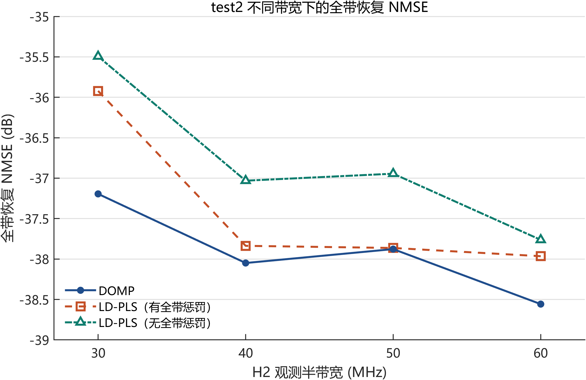
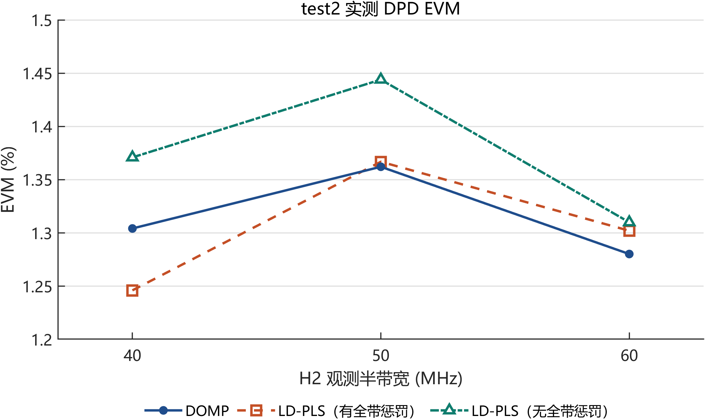
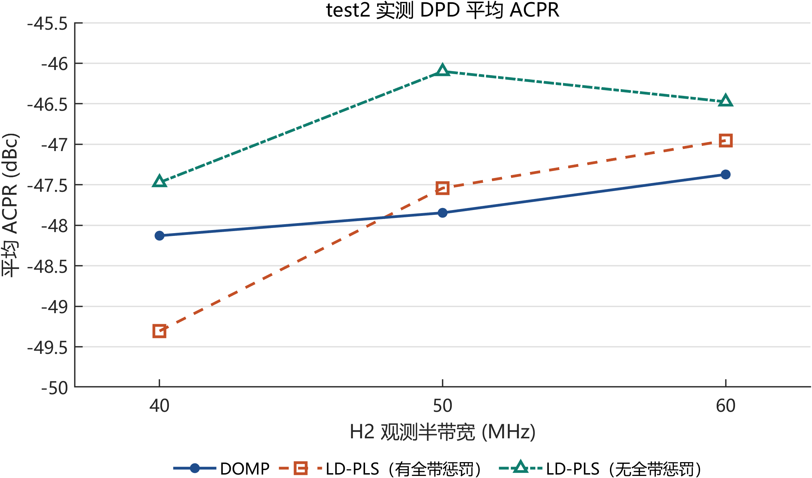
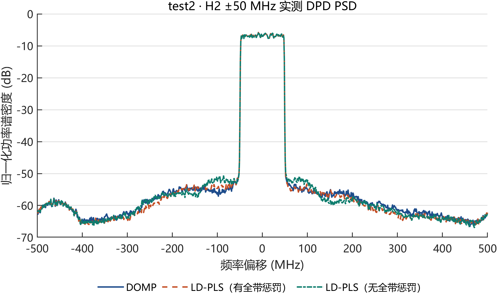
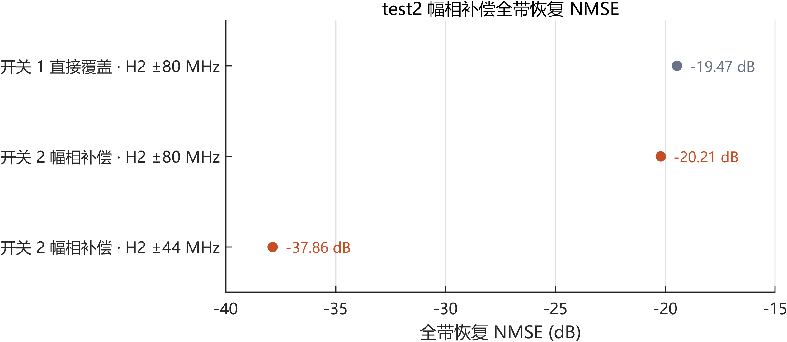

# test2 实验总结

## 1. 不同观测带宽下的全带恢复 NMSE

三种方法在每个带宽下共用同一组 38,400 点 IQ、同一带限观测和同一 MP 基函数矩阵（K=7、M=5）。以数字端 H2 的单边通带边缘 BW 标记每组反馈配置。模拟段 H1 随观测带宽重设计，数字端 H2 随 H1 配套调整。H1 的通带与阻带边缘为 BW+5 和 BW+10 MHz，H2 为 BW 和 BW+3 MHz。每个带宽对应一组完整的模拟和数字反馈设置。DOMP 和无惩罚 LD-PLS 分别扫描阶数，有惩罚 LD-PLS 还逐个带宽扫描惩罚强度 μ。拟合、选参和评分共用同一条记录，图表给出样本内全带恢复 NMSE，数值越低越好。

| H2 观测半带宽（MHz） | DOMP（dB） | LD-PLS，有全带惩罚（dB） | LD-PLS，无全带惩罚（dB） |
|---:|---:|---:|---:|
| 30 | **−37.194** | −35.921 | −35.494 |
| 40 | **−38.049** | −37.837 | −37.031 |
| 50 | **−37.877** | −37.863 | −36.945 |
| 60 | **−38.557** | −37.965 | −37.763 |

DOMP 在四个带宽下的全带恢复 NMSE 均最低，其中 60 MHz 的 −38.557 dB 为本组最低值。有全带惩罚的 LD-PLS 比无惩罚版改善 0.20–0.92 dB，50 MHz 时与 DOMP 仅相差 0.014 dB。

[30 MHz 明细](recovery_nmse/test2_bw30_fullband_nmse.md) · [40 MHz 明细](recovery_nmse/test2_bw40_fullband_nmse.md) · [50 MHz 明细](recovery_nmse/test2_bw50_fullband_nmse.md) · [60 MHz 明细](recovery_nmse/test2_bw60_fullband_nmse.md) · [MATLAB 绘图程序](scripts/plot_recovery_nmse_vs_bandwidth.m)

39 MHz 补充扫描按同一规则联动 H1 和 H2。三种方法的全带恢复 NMSE 均高于 40 MHz，具体结果见 [39 MHz 明细](recovery_nmse/test2_bw39_fullband_nmse.md)。

## 2. 实测 DPD

对比 DOMP、有全带惩罚 LD-PLS 和无全带惩罚 LD-PLS 在 H2 观测半带宽为 40、50、60 MHz 时的 PA 输出回采。每组用对齐后的全部 38,400 对 IQ 计算 EVM。ACPR 的主信道和邻道宽度均为 100 MHz，左右邻道中心偏移分别为 −100 MHz 和 +100 MHz。平均 ACPR 将左右邻道的功率比在线性域取平均，再转换为 dBc。30 MHz 尚无对应的实测回采。

### EVM

| H2 观测半带宽（MHz） | DOMP | LD-PLS，有全带惩罚 | LD-PLS，无全带惩罚 |
|---:|---:|---:|---:|
| 40 | 1.304% | **1.246%** | 1.371% |
| 50 | **1.362%** | 1.367% | 1.444% |
| 60 | **1.280%** | 1.302% | 1.310% |

### 平均 ACPR

| H2 观测半带宽（MHz） | DOMP（dBc） | LD-PLS，有全带惩罚（dBc） | LD-PLS，无全带惩罚（dBc） |
|---:|---:|---:|---:|
| 40 | −48.13 | **−49.31** | −47.47 |
| 50 | **−47.85** | −47.54 | −46.10 |
| 60 | **−47.37** | −46.95 | −46.48 |

40 MHz 有全带惩罚的 LD-PLS 同时取得最低 EVM 和最低平均 ACPR。在 50 和 60 MHz 下，DOMP 的两项指标均为各自带宽下最低。和同带宽无惩罚 LD-PLS 相比，有惩罚版的平均 ACPR 分别改善 1.83、1.44 和 0.48 dB。

[MATLAB 指标计算与绘图程序](scripts/plot_dpd_metrics_vs_bandwidth.m)

### ±50 MHz 实测 DPD PSD

三条曲线分别来自 DOMP、有全带惩罚 LD-PLS 和无全带惩罚 LD-PLS 的 PA 输出回采。先将各组与原始 IQ 做时延和相位对齐，再将 RMS 统一到归一化输入的 RMS。Welch PSD 使用 1 GS/s 采样率、1024 点 Hann 窗和 50% 重叠，纵轴沿用 LD-PLS 主程序的 10 log10(100P) 显示尺度。

[MATLAB 实测 DPD PSD 绘图程序](scripts/plot_dpd_psd_bw50.m)

## 3. 幅相补偿

### 实验设置

用 test2 的原始输入 IQ 和实测 PA 输出 y0，模拟 1 GS/s 反馈链。H1 固定为 12 阶椭圆低通 IIR，通带和阻带边缘为 85 MHz 和 90 MHz，通带波纹为 1 dB，阻带衰减为 80 dB。开关 1 从 H2(H1(y0)) 恢复 PA 输出。开关 2 旁路 PA，用 x 与 H1(x) 的互谱估计残余相位和归一化幅度，再将校准 FIR 与 H2 卷积后用于模型侧。幅相可靠估计范围为 −48.95 至 +48.71 MHz。

### 全带恢复

三组恢复信号与全带参考对齐后，均用全部 38,400 点计算 NMSE。±44 MHz 组采用联合扫描选出的 μ=0.01 和 11 个潜变量，岭系数为 λ=1。

| 恢复方式 | H2 观测半带宽（MHz） | 全带 NMSE（dB） |
|---|---:|---:|
| 开关 1 直接覆盖，模型侧仅 H2 | 80 | −19.47 |
| 开关 2 幅相补偿 | 80 | −20.21 |
| 开关 2 幅相补偿 | 44 | **−37.86** |

H2 为 80 MHz 时，幅相补偿使全带 NMSE 改善 0.74 dB。H2 为 44 MHz 时，通带位于幅相可靠估计范围内，调参后的全带 NMSE 比同一带宽的固定参数结果（−36.58 dB）改善 1.28 dB。 [幅相恢复明细](phase_amplitude/test2_phase_amplitude_fullband_nmse.md) · [MATLAB 绘图程序](scripts/plot_phase_amplitude_recovery_nmse.m)

### 实测 DPD 回采

使用全样本最优恢复信号生成 MP（K=7、M=5）预失真发送 IQ。重采记录按第二节相同口径计算 EVM 和平均 ACPR。

| 观测半带宽 | EVM | 左侧 ACPR | 右侧 ACPR | 平均 ACPR |
|---|---:|---:|---:|---:|
| 44 MHz | **1.470%** | −43.91 dBc | −46.23 dBc | **−44.92 dBc** |

[全样本最优恢复 IQ](../Phase_Amplitude_Calibration/y_test2_switch2_amp_phase_bw44_mu0p01_O11_all.mat) · [DPD 发送 IQ](../Phase_Amplitude_Calibration/z_test2_switch2_amp_phase_bw44_mu0p01_O11_all_mp75.dat) · [本次 PA 回采](../Phase_Amplitude_Calibration/y_dpd.bin)
